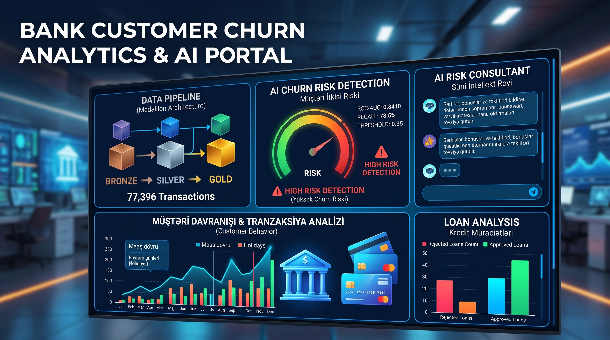
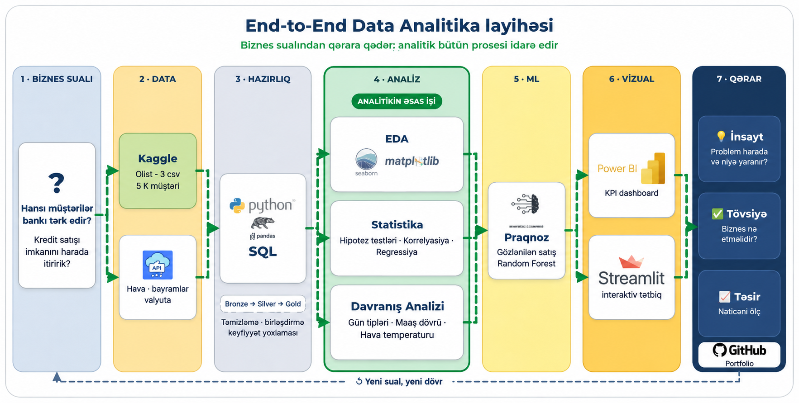
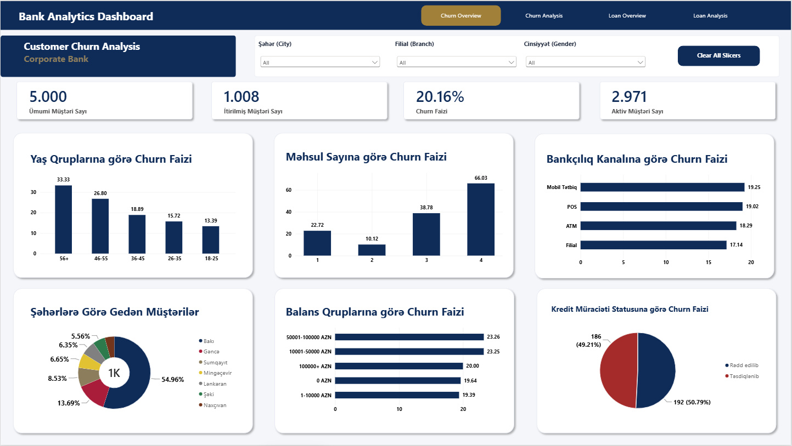

<p align="center">
  
</p>

# 🏦 End-to-End Banking Data Analytics
Customer Churn | Loan Analytics | Transaction Behavior | Predictive Modeling

---
## Project Overview

This end-to-end Banking Data Analytics project focuses on analyzing customer behavior, loan applications, financial transactions, and customer churn.

The project aims to integrate banking datasets with external weather, exchange rate, and calendar data to support data-driven business decisions through statistical analysis, interactive Power BI dashboards, and predictive modeling.


## Project Objectives

- Analyze customer churn, retention patterns, and loan application outcomes.
- Investigate how calendar events, exchange rates, and weather conditions relate to customer transaction behavior.
- Develop predictive models to support banking decisions and risk assessment.
- Deliver actionable insights through interactive Power BI dashboards and a Streamlit application.


## Business Questions

The project addresses four key business questions:

1. **Loan Sales Forecasting:** How much loan sales volume is expected across bank branches next month, and how should branches prepare?

2. **Customer Churn & Retention:** Which customers are at risk of leaving the bank, and is retaining them financially worthwhile?

3. **Loan Application Analysis:** Where are potential loan sales opportunities being lost during the loan application process?

4. **Customer Behavior Analysis:** How do holidays, salary days, exchange rates, and weather conditions influence customer transaction behavior?


## End-to-End Project Workflow

<p align="center">
  
</p>


## Technologies & Tools

| Technology | Purpose |
|---|---|
| **Python (3.14)** | Data processing, analysis, pipeline architecture, and predictive modeling |
| **Pandas & NumPy** | Data manipulation, currency conversions, aggregation, and data cleaning |
| **SQL Server** | Data storage and management using Medallion Architecture (Bronze–Silver–Gold) |
| **Jupyter Notebook** | Documentation of Exploratory Data Analysis (EDA) and statistical analyses |
| **SciPy & Statsmodels** | Statistical hypothesis testing (Welch's t-test, Shapiro–Wilk test, Spearman correlation, and linear regression) |
| **Scikit-Learn** | Machine learning model development, ColumnTransformer, Pipeline, and threshold optimization |
| **Power BI Desktop** | Interactive data visualizations and business dashboards for management decision-making |
| **Streamlit** | Development of an interactive web application and deployment of the AI Risk Consultant |
| **Joblib** | Serialization of trained ML models and optimized decision thresholds (`.pkl` files) |
| **Git & GitHub** | Version control, collaborative development, and automated deployment through Streamlit Cloud |


## Dataset Overview

The project uses synthetic banking datasets covering January–June 2026, enriched with calendar information and external API data.

| Dataset | Records | Key Attributes |
|---|---:|---|
| **Customers** | 5,000 | Customer ID, age, gender, city, branch, tenure, credit score, account balance, salary, number of products, card ownership, activity status, and churn status |
| **Transactions** | 77,396 | Transaction ID, customer ID, date, time, amount, currency (AZN, USD, EUR), transaction category, and channel |
| **Loans** | 4,820 | Loan ID, customer ID, application date, loan type, amount, term, interest rate, approval/rejection status, rejection reason, and default indicator |
| **Calendar** | 181 | Date, holiday status and name, weekend, working-day, and pre-holiday indicators |
| **External APIs** | — | Weather temperature, precipitation, wind indicators, and USD/EUR exchange rates |


### External Data Sources

- **[Open-Meteo Historical Weather API](https://archive-api.open-meteo.com/v1/archive):** Historical weather data across 7 cities, including daily average temperature, precipitation, and maximum wind speed.

- **[Frankfurter Exchange Rates API](https://api.frankfurter.dev/v2/rates):** Historical exchange rate data for AZN, USD, and EUR covering January–June 2026.

- **Calendar Reference (CSV):** Calendar data containing working days, weekends, public holidays, and estimated salary-day indicators.


**Note:** Record counts refer to the original datasets before data cleaning and transformation. Final record counts may differ after preprocessing.


## Data Architecture — Medallion Architecture

The project follows a three-layer Medallion Architecture in SQL Server to organize data integration, cleaning, and analytical reporting.

| Layer | Purpose |
|---|---|
| **Bronze** | Stores raw banking data and two enriched datasets integrating customer, loan, transaction, calendar, weather, and exchange rate information. |
| **Silver** | Contains cleaned and standardized loan and transaction datasets, with duplicate handling, missing value treatment, and data validation. |
| **Gold** | Contains 25 business-focused reporting tables for customer churn and loan application analysis, used to build Power BI dashboards. |


## Data Preparation & Cleaning

### Bronze Layer — Data Integration

The raw banking datasets were loaded into SQL Server and integrated with external data sources using Python and Pandas.

Two enriched datasets were created:

- **Loans Enriched:** Combined customer and loan records with calendar and weather data.
- **Transactions Enriched:** Combined transaction and customer records with calendar, weather, and currency exchange rate data.

The enriched datasets were stored in the SQL Server `bronze` schema.

### Silver Layer — Data Cleaning & Transformation

Both enriched datasets were processed to improve data quality, consistency, and reliability.

**Key cleaning operations:**

- **Data Type Conversion:** Standardized date columns and converted relevant numerical fields to appropriate data types.
- **Text Standardization:** Converted text values to lowercase and removed unnecessary whitespace.
- **Duplicate & Referential Integrity Handling:** Removed 15 duplicate loan records and 5 loan records linked to a customer ID missing from the customer dataset.
- **Missing Value Analysis:** Investigated missing values and distinguished expected nulls from data quality issues.
- **Loan Data Cleaning:** Filled missing interest rates for approved loans using median rates grouped by loan product type.
- **Rejection Reason Handling:** Replaced missing rejection reasons for rejected applications with an appropriate descriptive label.
- **Exchange Rate Handling:** Assigned an exchange rate of 1 to AZN-denominated transactions.
- **Data Validation:** Checked missing values in holiday-related fields to ensure consistency with calendar indicators.

The cleaned datasets were saved in the SQL Server `silver` schema as `silver.loans` and `silver.transactions`, and exported as CSV files for further analysis.


### Gold Layer — Business Analytics & Reporting

Using SQL queries and Python, **25 analytical reporting tables** were created from the cleaned Silver-layer data and stored in the SQL Server `gold` schema.

The analysis focuses on two main areas:

- **Customer Churn Analysis (15 tables):** Churn patterns across customer demographics, financial profiles, activity levels, and transaction behavior.
- **Loan Application Analysis (10 tables):** Loan approval and rejection rates, rejection reasons, application trends, and comparisons across customer segments and branches.

The Gold-layer tables were connected to **Power BI Desktop** to develop interactive dashboards supporting business decision-making.


## Power BI Dashboard & Business Insights

An interactive, four-page Power BI dashboard was developed using the SQL Server Gold-layer reporting tables to analyze customer churn and loan application performance.


<p align="center">
  
</p>

### Customer Churn Analysis

- **5,000 customers**, with **1,008 churned customers** and an overall **20.16% churn rate**.
- Inactive customers have a higher churn rate (**28.78%**) than active customers (**14.27%**).
- Customers aged **56+** have the highest churn rate (**33.33%**).
- Churn is particularly high among customers holding **four banking products (66.03%)**.

### Loan Application Analysis

- **4,800 loan applications**, with **2,975 approvals (62%)** and **1,825 rejections (38%)**.
- **Business loans** have the highest rejection rate among loan products (**approximately 74%**).
- Applications exceeding **50,000 AZN** have the highest rejection rate by loan amount group (**approximately 74%**).
- **High debt burden** is the most frequently recorded rejection reason.

The dashboard includes interactive filters for city, branch, gender, and loan product, enabling comparisons across customer segments and banking locations.


## Exploratory Data Analysis & Statistical Testing

Transaction behavior was analyzed using daily transaction counts and amounts converted to AZN, with a focus on calendar events, estimated salary periods, exchange rates, and weather conditions.

**Statistical methods:** Shapiro–Wilk normality test, Welch's t-test, Spearman correlation, Holm correction, and multiple linear regression (OLS) with HAC standard errors.

### Key Findings


- **Holidays:** Daily transaction amounts were 33.02% lower than on regular workdays, while the difference in transaction counts was not statistically significant. This decline was largely associated with the absence of high-value deposit and loan repayment transactions, despite increased shopping activity during holidays.
- **Salary Periods:** Estimated salary periods (days 1–5 and 25–end of month) were associated with higher transaction counts and amounts.
- **Exchange Rates:** EUR exchange rates showed a weak negative correlation with transaction activity, while USD showed no statistically significant relationship.
- **Weather:** Temperature initially showed a negative correlation with transaction activity, but the relationship was not statistically significant after accounting for month and day type.
- **Multivariable Analysis:** Salary periods and day types showed the strongest associations with transaction activity. The regression models explained 69.6% of variation in daily transaction counts and 74.6% in daily transaction amounts (R²).
**Business Insight:** Transaction activity is more strongly associated with salary periods and calendar patterns than with temperature or exchange rate movements after accounting for other factors.


## Machine Learning & Streamlit Dashboard

The project includes two predictive analytics solutions integrated into an interactive Streamlit dashboard.

### Customer Churn Prediction
- Built a **Random Forest Classifier** using customer, transaction, and loan data.
- Applied preprocessing, stratified train/validation/test splitting, and hyperparameter tuning.
- Evaluated model performance using ROC-AUC, Precision, Recall, F1-score, and Confusion Matrix.
- Integrated churn risk predictions and rule-based retention recommendations into Streamlit.

### Loan Sales Forecasting
- Forecasted branch-level loan sales for **July 2026** using January–June 2026 data.
- Compared a **5-month Moving Average baseline** with **Linear Regression**.
- Selected the Moving Average approach based on June test performance.
- Generated forecasts for 12 branches:
  - **493 approved loans**
  - **6,811,157.15 AZN** in predicted loan sales

*Forecasts are preliminary due to the limited six-month historical dataset.*

### Streamlit Dashboard

The application contains four sections:

1. **Branch Analytics** — performance indicators and visualizations.
2. **Customer Churn Simulator** — ML-based churn risk prediction and retention recommendations.
3. **Loan Sales Forecast** — branch-level forecasts, charts, and summary metrics.
4. **Model Metrics** — model architecture and evaluation results.

### Run the Application

```bash
python -m streamlit run app/main.py
```

**Main files:** `app/main.py`, `notebooks/3_Gold/06.Machine_Learning.ipynb`, and `models/`.


## 🚀 Live Demo

Try the Bank Customer Churn Risk Predictor application live:

📌 **Canlı Veb Portala Keçid:** []()

---

