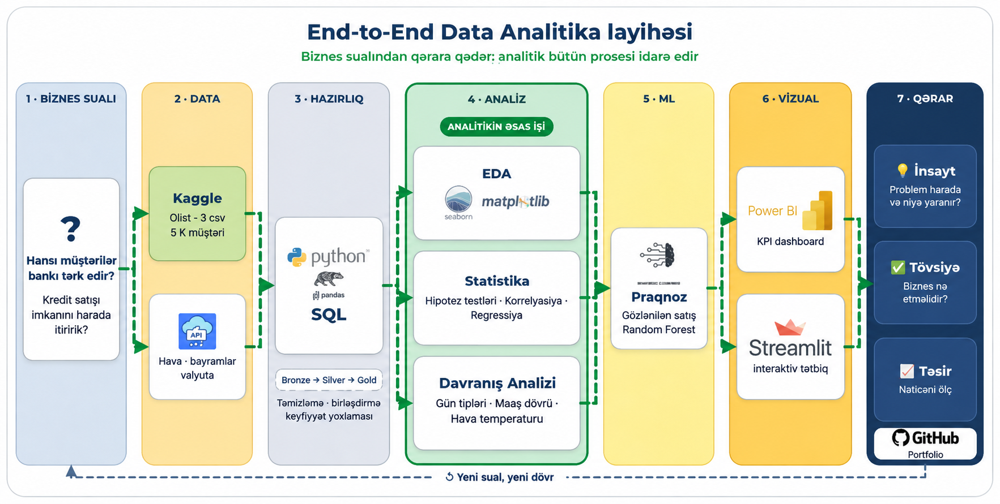

  

# 🏦 Bank Customer Churn Analytics & AI Prediction Portal

---

## 🚀 Live Demo

Try the Bank Customer Churn Risk Predictor application live:

📌 **Canlı Veb Portala Keçid:** [https://bank--churn-analysis.streamlit.app/](https://bank--churn-analysis.streamlit.app/)

---

## 📌 Layihə Haqqında

Bank sektorunda yeni müştəri cəlb etmək, mövcud müştərini saxlamaqdan (**Customer Retention**) 5 dəfə daha baha başa gəlir. Müştərilərin bankı tərk etməsi (**Churn**) maliyyə itkilərinə və bazar payının azalmasına birbaşa təsir göstərir.

**Bank Customer Churn Analytics & AI Portal** bank verilənlərinin təhlili, tarixi makro-iqtisadi və hava şəraiti göstəriciləri ilə zənginləşdirilməsi, statistik araşdırmaların aparılması və müştəri itkisinin öncədən proqnozlaşdırılması üçün Machine Learning modellərinin hazırlanmasını əhatə edən **End-to-End Data Analytics** layihəsidir.

Layihə məlumatların SQL-də Medallion arxitekturası üzrə işlənməsindən başlayaraq statistik təhlil, xüsusiyyətlərin yaradılması (Feature Engineering), proqnozlaşdırıcı modellərin qurulması və canlı AI veb-portalının təqdim edilməsinə qədər olan bütöv mərhələləri əhatə edir.

---

## 🎯 Layihənin Məqsədləri

* Müştərilərin bankı tərk etmə (**Churn**) riskini öncədən proqnozlaşdırmaq.
* Müştəri tranzaksiyalarına təsir edən makro-iqtisadi, təqvim və hava şəraiti faktorlarını statistik testlərlə araşdırmaq.
* Kredit müraciətlərində rədd cavabı alan müştərilərin Churn riski ilə əlaqəsini təhlil etmək.
* Disbalanslı data mühitində biznes maraqlarına uyğun optimal decision threshold (qərar həddi) təyin etmək.
* Filiallar, kredit satışı və tranzaksiya dinamikasını Power BI dashboard-ları vasitəsilə vizuallaşdırmaq.
* Streamlit üzərində bank menecerləri üçün avtomatik **AI Risk Consultant Engine** (Retention Plan) generatoru təqdim etmək.

---

## 📊 Əsas KPI-lar (Key Performance Indicators)

| İstiqamət | KPI-lar | Biznes Məqsədi |
| --- | --- | --- |
| **Kredit Proqnozu (ML & Streamlit)** | Proqnozlaşdırılan kredit sayı, filiallar üzrə gözlənilən kredit tələbi | Kredit tələbatını və satış həcmini öncədən planlaşdırmaq |
| **Müştəri İtkisi (Power BI)** | Churn Rate (%), Risk altında olan müştəri sayı, Retention Rate (%) | Müştəri itkisini izləmək və riskli müştəriləri vaxtında tutmaq |
| **Kredit Müraciətləri (Power BI)** | Approval Rate (%), Rejection Rate (%), Conversion Rate (%) | Kredit satışındakı dar boğazları və rədd olunma səbəblərini müəyyən etmək |
| **Müştəri Davranışı (Statistika)** | Gündəlik tranzaksiya sayı/məbləği (AZN), Average Ticket (AZN), Bayram və Maaş dövrü aktivlik fərqi (%) | Müştərinin maliyyə ritmini və xərcləmə vərdişlərini qiymətləndirmək |

---

## 🛠️ İstifadə Olunan Texnologiyalar

| Texnologiya | İstifadə Məqsədi |
| --- | --- |
| **Python (3.14)** | Məlumatların emalı, təhlili, pipeline arxitekturası və modelləşdirmə |
| **Pandas & NumPy** | Data manipulyasiyası, valyuta çevrilmələri, aqreqasiya və təmizləmə |
| **SQL Server** | Məlumatların Medallion arxitekturası (Bronze-Silver-Gold) üzrə saxlanılması |
| **Jupyter Notebook** | Exploratory Data Analysis (EDA) və statistik təhlillərin sənədləşdirilməsi |
| **SciPy & Statsmodels** | Hipotez testləri (Welch t-test, Shapiro-Wilk, Spearman Correlation, Linear Regression) |
| **Scikit-Learn** | ML modellərinin qurulması, ColumnTransformer, Pipeline və Threshold Optimization |
| **Power BI Desktop** | İcraçı rəhbərlik üçün interaktiv vizuallaşdırma və biznes dashboard-ları |
| **Streamlit** | Canlı interaktiv veb-portal və AI Risk Consultant mühərrikinin təqdim olunması |
| **Joblib** | ML modelinin və optimal biznes həddinin (`.pkl`) seriallaşdırılması |
| **Git & GitHub** | Versiyaların idarə edilməsi və Streamlit Cloud avtomatik deployment (CI/CD) |

---

## 📂 Məlumat Mənbələri

### 1. Bank daxili datasetlər (2026-cı il yanvar–iyun)

* **Customers (5,000 müştəri):** Yaş, cinsiyyət, şəhər, hesabdakı balans, illik gəlir, kredit skoru, istifadə etdiyi məhsul sayı və Churn statusu.
* **Loans (6,876 müraciət):** Kredit ID-si, müştəri ID-si, müraciət məbləği, statusu (*Təsdiqləndi / Rədd edildi*) və rədd səbəbləri.
* **Transactions (77,396 tranzaksiya):** Əməliyyat ID-si, məbləğ, valyuta (AZN, USD, EUR), əməliyyat tarixi və bayram günü göstəricisi (`is_holiday`).

### 2. Xarici zənginləşdirmə data mənbələri (External APIs)

* **Open-Meteo API:** Şəhərlər üzrə tarixi hava temperaturu və meteoroloji göstəricilər.
* **Frankfurter API:** USD/AZN və EUR/AZN valyuta məzənnələrinin dinamik tarixçəsi.
* **Calendar Reference:** İş, həftəsonu, bayram və ehtimal olunan maaş günləri haqqında təqvim məlumatları.

---

## 🔄 Layihənin İş Mərhələləri

  

### 1. Data Engineering Və Məlumatların Hazırlanması

* Relasiyalı verilənlər bazasındakı dağınıq cədvəllər `customer_id` açarı üzrə tək müştəri oxuna (1 Row Per Customer) gətirilmişdir.
* Foreign currency (USD, EUR) tranzaksiyaları dinamik məzənnə ilə vahid AZN ekvivalentinə çevrilmişdir.
* Müştəri narazılığını ölçmək üçün rədd edilmiş kredit sayı (`rejected_loan_count`) və orta xərcləmə məbləğləri yeni əlamət (Feature Engineering) kimi yaradılmışdır.

### 2. SQL Server Arxitekturası (Medallion Architecture)

Layihədə məlumatların mərhələli emalı üçün modern 3 qatlı yanaşmadan istifadə olunmuşdur:

| Qat (Layer) | Təyinatı |
| --- | --- |
| 🥉 **Bronze Layer** | Bank sistemindən gələn ilkin, işlənməmiş xam (raw) müştəri, tranzaksiya və kredit məlumatları. |
| 🥈 **Silver Layer** | Təmizlənmiş, deduplikasiya olunmuş, tipləri düzəldilmiş və kənar qiymətlərdən təmizlənmiş data. |
| 🥇 **Gold Layer** | Statistik analitikaya, Power BI dashboard-larına və ML təliminə hazır aqreqasiya olunmuş cədvəl (`gold_churn_predictions.csv`). |

### 3. Exploratory Data Analysis (EDA)

* Müştərilərin 20.16%-nin bankı tərk etdiyi (Churn Rate) müəyyən edilmişdir.
* Hesab balansı sıfıra yaxın olan və kredit müraciəti rədd edilən müştərilərdə Churn riskinin kəskin yüksəldiyi müşahidə olunmuşdur.
* Yaş və xərcləmə meylləri üzrə paylanmalar (distributions) və kənar qiymətlər (outliers) təhlil edilmişdir.

### 4. Statistik Təhlil Və Hipotez Testləri

* **Bayram Günləri Təsiri:** İş günlərinə nisbətən bayram günlərində tranzaksiya məbləği 33% aşağıdır. Lakin tranzaksiya sayındakı fərq statistik əhəmiyyətlilik həddinə çatmamışdır ($p > 0.05$).
* **Maaş Dövrü Təsiri:** Ehtimal olunan maaş günlərində tranzaksiya sayı **28.4%**, tranzaksiya məbləği isə **25.4% yüksəkdir**. Hər iki fərq statistik olaraq tam əhəmiyyətlidir ($p < 0.01$).
* **Valyuta Məzənnəsi (USD/EUR):** EUR kursu artdıqda tranzaksiya həcmi arasında zəif mənfi korrelyasiya müşahidə olunmuşdur.
* **Hava Temperaturu Təsiri:** Reqressiya modelinə mövsümilik (aylar) əlavə edildikdə temperaturun birbaşa effekti statistik əhəmiyyətini itirmişdir ($p > 0.05$).

### 5. Feature Engineering

* `total_trans_count` & `total_trans_amount`: Aktivlik və həcm göstəriciləri.
* `avg_trans_amount`: Bir dəfəyə xərclənən orta səbət məbləği.
* `holiday_trans_ratio`: Bayram günlərindəki xərcləmə payı.
* `rejected_loan_count`: Bankdan narazılıq indikatoru.

### 6. Machine Learning Və Biznes Həddinin (Threshold) Optimallaşdırılması

Müştəri itkisi ikili təsnifat (Binary Classification) məsələsi kimi modelləşdirilmişdir:

* **Hədəf dəyişən (`churned`):** `1` — Müştəri bankı tərk edir, `0` — Bankda qalır.
* **Data Leakage-Free:** Transformation addımları (`StandardScaler`, `OneHotEncoder`) yalnız `Train` dəstinə fit olunmuşdur.
* **Class Imbalance:** Random Forest modelində `class_weight='balanced'` parametrindən istifadə edilmişdir.
* **Threshold Tuning ($0.50 \rightarrow 0.35$):** Bank üçün gedəcək müştərini qaçırmaq (False Negative) daha zərərli olduğu üçün decision threshold **$0.35$-ə endirilmiş** və gedəcək müştəriləri tutma nisbəti (**Recall**) **78.5%**-ə yüksəldilmişdir.

---

## 📊 İlkin Analitik Nəticələr

* **ROC-AUC Balı:** `0.8410` (Modelin riski ayırt etmə qabiliyyəti yüksəkdir).
* **Recall (Gedənləri Tutma Faizi):** `78.5%` (Real gedəcək müştərilərin böyük əksəriyyəti öncədən təyin edilir).
* **Precision:** `52.3%` (Hədəflənən retention kampaniyalarının dəqiqliyi).
* **Maaş Günləri Aktivliyi:** Maaş günlərində kart əməliyyatlarının həcmi statistik əhəmiyyətli dərəcədə artır ($p < 0.01$).

---

## 📊 Biznes Insight-ları və Tövsiyələr

### 1. Müştəri İtkisi (Churn) & Balans Riski 📉

**Insight:**

* Müştərilərin 20.16%-i bankı tərk edir. Hesab balansı kritik həddən (2,000 AZN) aşağı olan müştərilərdə Churn meyli 3 dəfə yüksəkdir.

**Biznes Tövsiyələri:**

* Balansı düşən müştərilərə avtomatik +0.5% dərəcəli depozit hesabı və ya pulsuz kart xidməti təklif etmək.
* Müştəri hesabında passivlik yarandıqda stimullaşdırıcı kəşbek kampaniyaları işə salmaq.

### 2. Kredit Müraciətləri Narazılığı & Rədd Səbəbləri ⚠️

**Insight:**

* Kredit müraciəti rədd edilən müştərilər bankdan incəyərək hesablarını bağlamağa daha meyllidir (`rejected_loan_count` Top 10 Churn faktorları arasındadır).

**Biznes Tövsiyələri:**

* Rədd cavabı alan müştəriyə dərhal imtina vermək əvəzinə, daha kiçik həcmli və ya girovlu yumşaq alternativ kredit məhsulları təklif etmək.
* Kredit müraciəti rədd edilən riskli müştəriləri CRM sistemində xüsusi izləməyə götürmək.

### 3. Tranzaksiya Aktivliyi (Maaş Və Bayram Dövrü) 💰

**Insight:**

* Maaş günlərində tranzaksiya həcmi 28.4% artır, bayram günlərində isə əməliyyatlar azalır.

**Biznes Tövsiyələri:**

* Marketing bildirişlərini və kredit təkliflərini məhz maaş dövründən 1-2 gün əvvəl göndərmək.
* Bayram günlərində ticarət tərəfdaşları ilə birlikdə xüsusi bədəlli kampaniyalar keçirmək.

### 4. Proqnozlaşdırıcı AI Və Qərarvermə (AI Risk Consultant Engine) 🤖

**Insight:**

* Streamlit portala inteqrasiya edilmiş AI mühərriki müştərinin risk profilini anlıq təhlil edərək avtomatik **Retention Plan** yaradır.

**Biznes Tövsiyələri:**

* Filial menecerlərinin gündəlik iş prosesinə AI Risk Konsultantının tövsiyələrini inteqrasiya etmək.
* Power BI dashboard-ları vasitəsilə filiallar üzrə riskli müştəri siyahılarını canlı izləmək.

---

## 🎯 Gözlənilən Biznes Faydaları

| İstiqamət | Gözlənilən Fayda |
| --- | --- |
| **Müştəri Retention** | Gedəcək müştərilərin 78.5%-ni öncədən müəyyən edərək saxlamaq |
| **Maliyyə Səmərəliliyi** | Yeni müştəri cəlb etmə xərclərinə (CAC) 5 dəfəyə qədər qənaət etmək |
| **Kredit Satışı** | Rədd edilmiş müraciətləri alternativ məhsullara yönəldərək konversiyanı artırmaq |
| **Əməliyyat Effektivliyi** | Filial menecerlərinin AI tövsiyələri ilə daha sürətli qərar verməsini təmin etmək |
| **Data-Driven Qərarlar** | Subyektiv mülahizələr əvəzinə statistik və ML modellərinə əsaslanmaq |

---