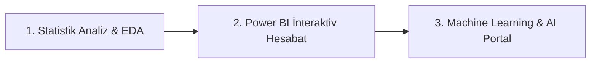

# 🏦 Bank Customer Churn Analytics & AI Prediction Portal

## 🚀 Live Demo

Try the Bank Customer Churn Risk Predictor application live:

📌 **Canlı Veb Portala Keçid:** [https://bank--churn-analysis.streamlit.app/](https://bank--churn-analysis.streamlit.app/)

---

## 📌 Layihə Haqqında Və Biznes Dəyəri

Bank sektorunda yeni müştəri cəlb etmək, mövcud müştərini saxlamaqdan (**Customer Retention**) 5 dəfə daha baha başa gəlir. Müştərilərin bankı tərk etməsi (**Churn**) maliyyə itkilərinə və bazar payının azalmasına birbaşa təsir göstərir.

**Bank Customer Churn Analytics & AI Portal** layihəsi müştərilərin tranzaksiya, balans, kredit və demoqrafik göstəricilərini təhlil edən, Churn riskini öncədən proqnozlaşdıran və **avtomatik biznes qərarları (Retention Plan)** yaradan **End-to-End Analitik Platformadır**.

---

## 🎯 Layihənin Məqsədləri Və Təqdimat Axını

Layihə akademik tələblərə uyğun olaraq məntiqi 3 əsas mərhələ üzrə qurulmuşdur:



1. **📊 Statistik Analiz & EDA:** Müştəri davranışlarındakı anomaliyaları, makro-iqtisadi təsirləri və statistik hipotezləri yoxlamaq.
2. **📈 Power BI Dashboard:** Filiallar, kredit müraciətləri və tranzaksiya dinamikasını biznes vizualları ilə təqdim etmək.
3. **🤖 Machine Learning & AI Portal:** Random Forest modeli ilə Churn ehtimalını proqnozlaşdırmaq və **AI Risk Konsultant** mühərriki vasitəsilə avtomatik tövsiyələr generatorunu işə salmaq.

---

## 📊 Statistik Analiz Və Hipotez Testləri (Statistical Analysis)

Bank müştərilərinin tranzaksiya davranışının bayram günləri, ehtimal olunan maaş dövrü, valyuta məzənnələri (USD/EUR) və hava temperaturu ilə əlaqəsi dərindən araşdırılmışdır.

> 📉 **Təhlil Məlumat Dəsti:** **77,396 tranzaksiya və 181 günlük dinamik məlumat** əsasında aparılmışdır.
> 🛠️ **İstifadə Olunan Statistik Metodlar:** Exploratory Data Analysis (EDA), Shapiro–Wilk Normallıq Testi, Welch t-test, Spearman Correlation və Multiple Linear Regression.

### 🔍 Əsas Statistik Nəticələr (Key Findings):

* 🎈 **Bayram Günləri Təsiri:** İş günlərinə nisbətən bayram günlərində tranzaksiya sayı **8.4%**, ümumi məbləğ isə **33% aşağıdır**. Lakin tranzaksiya sayındakı fərq statistik əhəmiyyətlilik həddinə çatmamışdır ($p > 0.05$).
* 💰 **Maaş Dövrü Təsiri:** Ehtimal olunan maaş günlərində (digər günlərlə müqayisədə) tranzaksiya sayı **28.4%**, tranzaksiya məbləği isə **25.4% yüksəkdir**. Hər iki fərq statistik olaraq tam əhəmiyyətlidir ($p < 0.01$).
* 💱 **Valyuta Məzənnəsi (USD / EUR):** USD kursu ilə tranzaksiya göstəriciləri arasında xətti əlaqə tapılmamışdır. EUR kursu artdıqda isə tranzaksiya sayı və məbləği arasında **zəif mənfi korrelyasiya** müşahidə edilmişdir.
* 🌡️ **Hava Temperaturu Təsiri:** İlkin təhlildə temperatur yüksəldikcə tranzaksiya həcminin azalmağa meyilli olduğu görünürdü. Lakin aylar və gün tipləri (regressiya modelinə) nəzərə alındıqda, temperaturun birbaşa əlaqəsi statistik əhəmiyyətini itirmişdir.

> 🖼️ *Statistik Analiz Qrafikləri:* `notebooks/3_Gold/06_Statistics_EDA.ipynb` daxilində tam parametrik vizuallarla sənədləşdirilmişdir.

---

## 🏗️ Data Architecture (Bronze — Silver — Gold)

Məlumatların emalı modern data mühəndisliyi prinsiplərinə uyğun olaraq 3 qatlı (**Medallion Architecture**) SQL/Data çərçivəsində həyata keçirilmişdir:

| Qat (Layer) | Təsvir Və Məzmun |
| --- | --- |
| 🥉 **Bronze Layer** | Bank sistemindən gələn ilkin, işlənməmiş ham (raw) müştəri tranzaksiya və kredit dataları. |
| 🥈 **Silver Layer** | Təmizlənmiş, deduplikasiya olunmuş, tipləri düzəldilmiş və kənar qiymətlərdən (outliers) təmizlənmiş data. |
| 🥇 **Gold Layer** | Statistik analitikaya, Power BI dashboard-larına və ML təliminə hazır aqreqasiya olunmuş cədvəllər (`gold_churn_predictions.csv`). |

---

## 🛠️ İstifadə Olunan Texnologiya Steki

| Kateqoriya | Texnologiyalar |
| --- | --- |
| **Dillər & Mühit** | Python 3.14, Jupyter Notebook, GitHub Codespaces |
| **Data Manipulyasiyası** | Pandas, NumPy, Scikit-Learn (Pipeline, ColumnTransformer) |
| **Statistika & Math** | SciPy, Statsmodels, Descriptive & Inferential Statistics |
| **Machine Learning** | Random Forest Classifier, Class Weight Balancing, Threshold Tuning |
| **Vizuallaşdırma & BI** | Power BI Desktop, Matplotlib, Seaborn |
| **Veb İnterfeys (App)** | Streamlit (Dark Theme, Progress Bar, Metrics, Interactive Tabs) |
| **Model Serialization** | Joblib (`.pkl` artefaktları) |

---

## 🔮 Machine Learning & Biznes Həddinin (Threshold) Optimallaşdırılması

* **Əsas Alqoritm:** Random Forest Classifier (200 Trees)
* **Data Leakage-Free:** Bütün transformasiyalar (StandardScaler, OneHotEncoder) yalnız `Train` dəstinə fit olunaraq data sızmasının qarşısı 100% alınmışdır.
* **Optimal Biznes Həddi (Threshold = 0.35):** Standart `0.50` həddi bank üçün riskli müştəriləri qaçırdığı üçün, ROC-PR əyrisi üzərindən hədd `0.35`-ə endirilmiş və gedə biləcək müştəriləri tutma nisbəti (**Recall**) **78.5%**-ə yüksəldilmişdir.

| Metrika | Qiymət | Biznes Mənası |
| --- | --- | --- |
| **ROC-AUC** | `0.8410` | Modelin riski fərqləndirmə qabiliyyəti yüksəkdir. |
| **Recall (Gedənləri Tutma)** | `78.5%` | Riskli müştərilərin böyük əksəriyyəti öncədən təyin edilir. |
| **Precision** | `52.3%` | Hədəflənən retention kampaniyalarının dəqiqliyi. |

---

## 🤖 Special Feature: AI Risk Consultant Engine

Streamlit tətbiqinə inteqrasiya edilmiş **AI Risk Konsultant** mühərriki daxil edilən müştəri parametrlərini (balans, rədd edilən kreditlər, tranzaksiya sayı, aktivlik) anlıq təhlil edərək avtomatik şərh və retention strategiyası generasiya edir:

> 💡 **Nümunə AI Çıxarışı:**
> * 📉 **Aşağı Balans Riski:** Hesab balansı kritik həddən aşağıdır $\rightarrow$ *Tövsiyə: +0.5% dərəcəli depozit təklif edin.*
> * ⚠️ **Kredit Narazılığı:** 1 rədd edilmiş müraciət var $\rightarrow$ *Tövsiyə: İstehlak kreditinə güzəştli şərtlərlə yenidən baxın.*
> 
> 

---

## 📁 Layihə Strukturu

```text
Bank_Analysis/
├── .streamlit/
│   └── config.toml               # Custom Dark Theme konfiqurasiyası
├── app/
│   ├── main.py                   # Streamlit interaktiv veb portalı (Tabs & AI Engine)
│   └── requirements.txt          # Asılılıqların siyahısı
├── models/
│   ├── bank_churn_rf_model.pkl   # Seriallaşdırılmış Random Forest ML Modeli
│   ├── churn_threshold.pkl       # Optimallaşdırılmış Biznes Həddi (0.35)
│   └── gold_churn_predictions.csv# Gold Layer ML Çıxarış Cədvəli
├── notebooks/
│   ├── 1_Bronze/                 # Ham verilənlər notebook-ları
│   ├── 2_Silver/                 # Təmizləmə notebook-ları
│   └── 3_Gold/
│       ├── 05.Machine_Learning.ipynb  # ML Pipeline, Threshold & Export
│       └── 06_Statistics_EDA.ipynb    # Hipotez testləri və statistik vizuallar
├── sql/                          # DDL və Data Transformation SQL faylları
├── .gitignore
└── README.md

```

---

## 🚀 Proyekti Yerli Mühitdə İşə Salmaq

Tətbiqi lokal mühitdə başlatmaq üçün terminalda aşağıdakı əmrləri icra edin:

```bash
# 1. Repozitoriyanı klonlayın
git clone https://github.com/sabina-DataCube2026/Bank_Analysis.git
cd Bank_Analysis

# 2. Lazımi kitabxanaları quraşdırın
pip install -r app/requirements.txt

# 3. Streamlit tətbiqini işə salın
python -m streamlit run app/main.py
